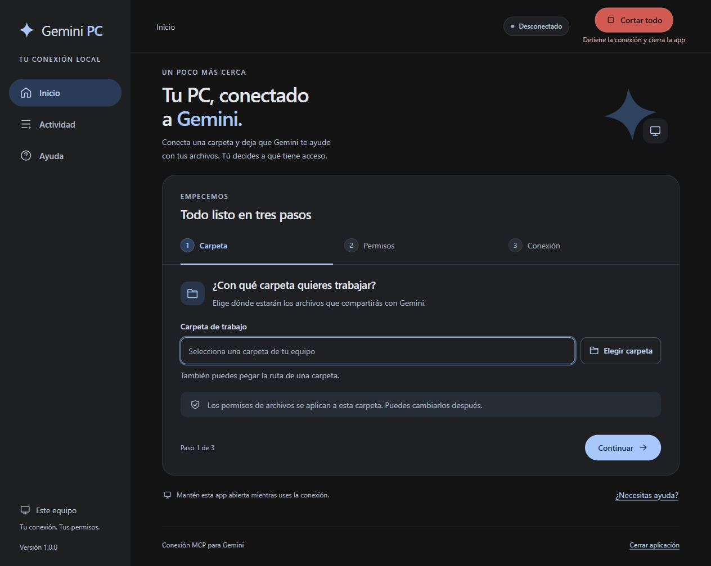

# Gemini PC

Conecta una carpeta de tu equipo con Gemini desde una interfaz gráfica sencilla, en español y con modo oscuro predeterminado.

Versión **1.0.0**. El botón rojo **Cortar todo** detiene la conexión de la app y cierra el panel sin pedir confirmación, incluso si hay una operación en curso.



## Empezar

1. Instala [Node.js 22 o posterior](https://nodejs.org/) y [Git](https://git-scm.com/downloads).
2. En Windows, abre **Abrir Gemini.vbs**. También puedes usar `iniciar-gemini.cmd`. En Linux/macOS, ejecuta `./iniciar-gemini.sh`.
3. Elige tu carpeta, los permisos y el destino: Gemini web o Gemini CLI.
4. Para Gemini web, inicia la conexión y copia su URL. En Gemini, entra en **Conectores → + → Agregar conector personalizado**.

La primera configuración descarga el servidor MCP fijado y sus dependencias. Cada persona configura sus propias credenciales. El paquete público no incluye ajustes privados, cuentas ni registros de uso.

Consulta [la guía completa](LEEME.md) para configurar ngrok, autorizar el acceso, revisar permisos y resolver problemas. Los detalles de las pruebas están en [VALIDACION.md](VALIDACION.md).

## Desarrollo

```sh
npm start
npm run check
npm test
npm run test:oauth
npm run package:public
```

Las pruebas que necesitan el servidor instalado se omiten cuando falta. La prueba OAuth requiere completar antes la instalación del motor.

La carpeta `para-github/gemini-pc` contiene la copia preparada para publicar, generada mediante una lista explícita de archivos. No subas tu instalación de trabajo completa ni el directorio `servidor/`.

Proyecto independiente, sin afiliación con Google. El servidor base es [vicktorgabriel/mcp-server](https://github.com/vicktorgabriel/mcp-server); la revisión y las mejoras locales se detallan en [UPSTREAM.json](UPSTREAM.json).

## Licencia

Este proyecto se publica bajo la [licencia MIT](LICENSE). Puedes usarlo, modificarlo y distribuirlo, incluso con fines comerciales, conservando el aviso de licencia.

El servidor MCP se descarga por separado desde su proyecto original, que declara licencia MIT. Sus dependencias conservan sus respectivas licencias; no se incluyen en esta copia pública.
